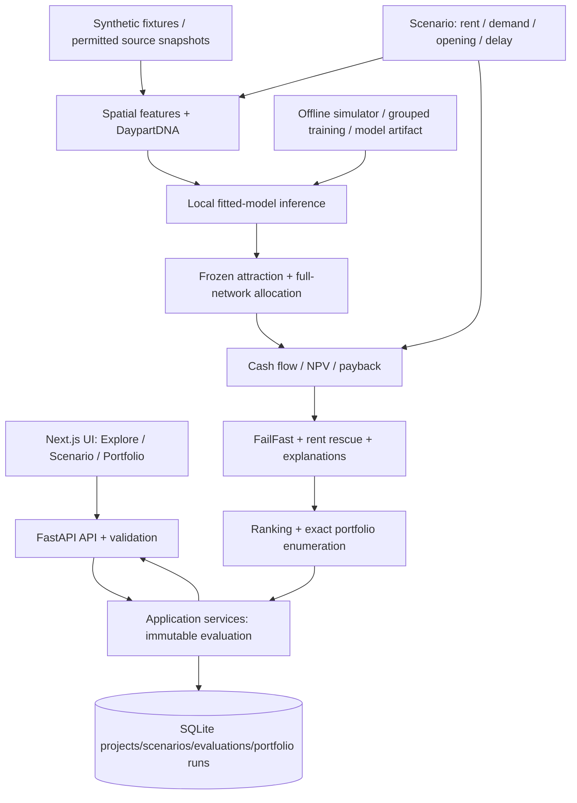

# StoreScout architecture

One local operator, one Navi Mumbai grocery demonstration, 10 candidates/four fictional branches. The complete PRD remains authoritative. The frontend workspace now connects to backend orchestration, atomic persistence and a deterministic assumption-based numerical pipeline. No trained ML model is active; that acceptance gate remains open.

## Boundaries and ownership

| Owner | Paths | Receives / produces |
| --- | --- | --- |
| Frontend | frontend/ | API envelopes -> interactive map/table, comparison, edits, portfolio/report; no economic calculations |
| Logic | backend/app/domain/, ml/, tests/unit/ | frozen input dictionaries -> computed domain dictionaries, fitted artifact, invariants |
| Backend + integration | backend/app/main.py, schemas.py, api/, services/, repositories/, contracts/, data/, root files, tests/contract/ | validates input -> loads scenario/snapshot -> calls logic -> validates full output -> atomic save -> response |

The nine logical layers remain ingestion, spatial, demand, network, finance, evidence/risk, scenario, ranking and portfolio. They are Python modules, not independent services. DaypartDNA lives in spatial/evidence; FailFast uses finance and eligibility. No queue, Redis, PostGIS server, live paid API or external LLM is required for H4.

## Canonical input and result flow

1. UI fetches `/projects/demo`; scenario creation stores a complete assumption snapshot. The baseline is immutable.
2. Backend loads project, exact scenario and synthetic source files, then passes them to `domain.pipeline.run_evaluation`. File loading is backend-owned; pass prepared sources in an internal `project['inputs']` dictionary rather than hiding disk reads in numerical functions.
3. Logic prepares cells/POIs, runs the fitted model, calibrates candidate attraction in an external-competitor-only reference, then freezes coefficients. Own-branch coverage is excluded from model features.
4. The same wallet and denominator produce before/after existing-branch allocation; lost contribution is deducted once. Finance produces yearly cash flows, NPV, ROI and payback. Downside, rules, rescue and rank follow.
5. Backend adds evaluation ID/time, model/data/rule IDs, validates `EvaluationData`, and commits the entire result plus private frozen-network context in one transaction. A failure commits nothing.
6. Portfolio service loads that evaluation's scenario budget, prepared network and exact versions. Logic enumerates at most 1,024 subsets, recomputing the full network. It returns exact or partial status; backend adds run identity, validates, rechecks budget and saves.
7. A rent-only edit reuses geographic/model inputs but reruns finance/status/rank/portfolio. Global demand changes wallets; infrastructure effects change the standalone target once per affected period. Current/Opens/Delayed use the same valuation date.

The public `EvaluationData` intentionally excludes internal attraction matrices. Persist them with the evaluation (or a reconstructable snapshot reference); portfolio computation must not guess them from rounded displayed site values.

## Four-hour choices

- **SQLite + local JSON/GeoParquet:** immediate local persistence, one operator. A server database is deferred.
- **100 synthetic cells initially:** correct bounded allocation before raising the cap toward 2,000. A resolution change produces a new snapshot ID.
- **Fitted linear baseline before CatBoost if needed:** same feature/target contract and held-out report. By H4 a real fitted artifact must drive results; formula-only mode remains visibly incomplete.
- **Exact enumeration:** at most 10 sites; avoids a second solver and pairwise approximation. A five-second deadline returns a valid incumbent with an unknown gap if incomplete.
- **MapLibre over local synthetic GeoJSON:** no online tile dependency; table remains fully usable.
- **Three UI screens:** Explore & Compare, Scenario & Rescue, Portfolio & Report. Start with a table, then add map layers.

## Failure and safety behaviour

Unconnected analytics now return `503 ENGINE_UNAVAILABLE`. Backend only saves validated computed output. Errors distinguish 422 invalid input, 404 unknown/cross-project objects, 409 stale versions/idempotency conflicts, 502 invalid analytical output and 503 unavailable computation. Client cancels obsolete requests and checks evaluation/scenario IDs before displaying responses. There is one atomic evaluation/context save, never independent financial/map/portfolio updates.

H4 is a connected prototype; it must demonstrate truthful data/method labels, not claim all AC01-32 passed. Remaining PRD behaviours are tracked in STATUS. No user data or credentials are sent to external services by this scaffold.
