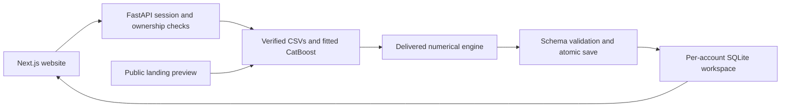

# Integration workflow

Branch `full-integration`; frontend/backend baseline `ff6d2c3`, ML baseline `d7373f8`.

1. Load the revised Bengaluru candidates, business assumptions and exact ML `build_project()` CSV/inference mapping. Only this read helper is called; the offline report runner is not executed. The public project route remains `demo`; snapshot identity explicitly identifies Bengaluru.
2. Verify selected-model, feature-schema and support hashes. The delivered CatBoost model, training inputs and active numerical engine remain unchanged.
3. Call `prepare_evaluation`. Map its results/evidence into the wire schema, allocate backend IDs/timestamps, validate, and save the full sealed network context and public evaluation atomically.
4. Portfolio and rescue calls reuse that exact saved context; they never reconstruct it from displayed values. Duplicate requests reuse results. Source/model/code changes require re-evaluation. Saved reports remain readable.
5. The frontend exposes only supported budget, demand/rent, site rent/sales and infrastructure controls. Six dayparts, stress cases, existing-store impacts and geographic evidence use the matching evaluation. No client financial engine or fallback financial scores.
6. Rescue returns a verified canonical site override. Applying it creates an immutable scenario and evaluates again. Base rent precedes the global rent multiplier; sales overrides are absolute baseline multipliers, while search bounds are relative to the current target. A viable bound is distinct from a zero-NPV root. Other risks remain.
7. Portfolio selection uses exact full-network enumeration for at most ten candidates, with budget/count caps, explicit per-site risk acknowledgement, an empty zero option, and truthful partial-search status. It is not a claimed OR-Tools integration.
8. Reports use escaped saved content and matching evaluation/portfolio IDs. The public landing preview computes from the shared snapshot without any account data.

The future infrastructure record is the supplied Phase 2A project. An actual OSM alignment vertex, chosen near its centre, supplies a representative Point proxy for the delivered engine. It is not a verified station. Opening dates and commercial effects are scenario assumptions. Baseline treatment excludes future uplift; domain timing/exposure math is unchanged.

Accounts use salted scrypt passwords, random sessions stored as token hashes, HttpOnly/SameSite cookies, throttling and origin checks. All saved-resource lookups run in the authenticated account context. Server-side preferences restore the last saved view and check analytical freshness. Runtime data is Git-ignored; deployment needs persistent disk and backups. Hosting and managed databases are not provisioned by this integration.

The acceptance script covers the selected runtime. Historical training audits remain untouched and need their original artifact sets. Integration tests do not establish real-sales accuracy or calibrated prediction intervals.
